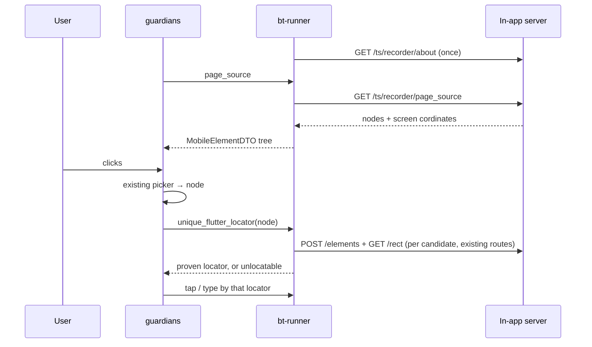

# Flutter Recorder support in the Testsigma Flutter server

| | |
|---|---|
| **Base** | `appium-flutter-server` `main` (v0.0.34) |
| **Scope** | The Dart server that runs inside the customer app.  |
| **Rule** | Add new code. Reuse existing code. Do not change existing behaviour. |

---

## 1. Problem Statement
- Arcus needs a Flutter recorder that works when the app exposes **no semantics**. 
- Without semantics the current implementation will not able to inspect elements.

- Current Flutter server provides `render_tree` (which consists of widgets)
- Arcus needs to find out whether customer has installed support package.

#
**Problems with current render_tree endpoint** -

- render_tree  endpoint gives out a huge list of widgets, in which most of them are unnecessary, are bloated.
- render_tree doesnt provide co-ordinates with respect to view port. As a result. Current frontend cannot render inspector style UI.


## 2 Solution:

Adding two endpoint to the server

| Endpoint | Answers the question |
|---|---|
| `GET /ts/recorder/about` | "Does this app have the recorder, and which version?" |
| `GET /ts/recorder/page_source` | "What is on the screen, and where?". |


---

## 3. Goals


1. Give Arcus a **small, flat list of the widgets that the user can see**, with their **real on-screen
   position**.
2. Shape each node like a **native page-source element**, so the existing groot and guardians
   pickers and panels work with little or no change.
3. Expose each widget's **finder values**, read exactly the way the finders read them, so bt-runner
   can build locators from them.
4. Work the same on Android and iOS, in debug and profile builds, with no change to the customer's
   app code.
5. Stay easy to merge with future upstream releases.


---

## 4. Background

### 4.1 What we reuse from the server : 

| Existing piece | File | How it is used |
|---|---|---|
| `RequestHandler`, `NoSessionCommandHandler` | `handler/request/*.dart` | Base for the two new handlers. Routing, logging and the error envelope come free. |
| `AppiumResponse` | `models/api/appium_response.dart` | Same `{sessionId, value}` response shape |
| `FlutterDriver.instance.tester` | `driver.dart` | Access to the live widget tree and the view |
| `ElementHelper.pumpAndTrySettle()` | `utils/element_helper.dart` | Waits for the UI to settle |
| `POST /session/:id/elements` | `handler/find_elements.dart` | bt-runner counts matches for a candidate locator. It runs the same `toFinder()` and the same visibility filter that replay runs. |
| `GET /session/:id/element/:id/rect` | `handler/get_rect.dart` | bt-runner checks that the match is the clicked widget. It returns the global rect, rounded to whole logical pixels, **as strings**. |


### 4.2 Current mobile recording flow : 

| Step | groot (`mobile-inspector`) | guardians (Arcus, via `@testsigmainc/mobile-inspector-core`) |
|---|---|---|
| Page source | bt-runner `GET …/session_actions/:sid/page_source` | Same route, plus the `x-page-source-hash` header to skip unchanged screens |
| Click → element | In the browser. Keeps the elements whose box contains the point, then the highest **priority** wins (input 100 > clickable with text 90 > toggle 85 > text 80 > … > container 3). A tie goes to the deeper element. `events.ts:193`, `elements.ts:894` | The same rules in `pickBestElement` (`index.mjs:315`), plus a swap from a field label to its input (`fieldBehind`) |
| Locators | xpath built in a worker. Other values come from the page-source fields. The order follows the user's preference (`step-utils.ts:262`). | accessibility id → resource id → uiautomator / predicate → xpath |
| Uniqueness | Counted in the local XML. Flutter locators have no count field, so they are **accepted unchecked** (`constants.ts:36`, `step-utils.ts:328`). | **Not checked** |


What that means for Flutter:

1. **The click picker already works on any tree with boxes, types and clickable flags.** If the
   flutter's page_source gives those, groot and guardians can pick Flutter widgets with the code they already
   have.
2. **Counting matches in the snapshot gives wrong answers for Flutter.** Every finder on `main` uses
   `skipOffstage: false`, so it also searches hidden tabs and covered pages, which the snapshot leaves
   out on purpose. Replay's visibility filter (`isVisibleOnAppScreen`) only checks overlap with the
   root box, so a hidden tab at the same position still passes it. Counts must come from the device.
3. **Flutter has no index fallback.** Native can fall back to `//Button[2]`, but Flutter finders have no such option. If no locator matches exactly one widget, the recorder must say “add a Key to this widget” instead of guessing.

---

## 5. Distribution: 

**Decision: keep the Dart package name `appium_flutter_server`, and ship it from Testsigma's git
repository.**

```yaml
# customer pubspec.yaml
dev_dependencies:
  appium_flutter_server:
    git:
      url: https://github.com/TestsigmaInc/appium-flutter-server
      path: server
      ref: v0.0.34-ts.1        # always a tag, never a branch
```

Why this choice:

- The customer's `integration_test/appium_test.dart` does **not** change.
- No rename means we don't touch the 226 internal `package:appium_flutter_server/...` imports across
  50 files, which would be a large, conflict-prone diff.
- Merging upstream releases stays cheap.

---

## 6. Design principles

1. **Additive only.** New files live in `lib/src/ts_recorder/`.  We extend and resue existing functionality so as not to hamper exsiting implementations.
2. **Describe, don't decide.** The server reports what is on screen. Picking an element and choosing
   a locator stay in the clients and bt-runner, as they do for native.
3. **Look like page source.** Node fields use the native page-source names (`clickable`, `enabled`,
   `checked`, `scrollable`, `focusable`), so bt-runner maps them one-to-one.

---


## 7. Detailed design

### 7.1 Folder Structure

```
server/lib/src/ts_recorder/

  recorder_routes.dart           > The “front door”: tells the server the two new URLs exist
  about_handler.dart             > Answers “do you have the recorder?”
  page_source_handler.dart       > Answers “what’s on screen?”

  page_source/
    tree_walker.dart            > Goes through every widget once and builds the list
    node.dart                   > The shape of one item in the list
    node_reader.dart            > Reads each widget’s key, text, icon and so on
    visibility.dart             > Decides “can the user actually see this?”
    screen.dart                 > Reads the screen size and pixel ratio

server/test/ts_recorder/

  tree_walker_test.dart
  visibility_test.dart
  node_reader_test.dart
  snapshot_handler_test.dart
```

### 7.2 Modification to current files

| File | Change |
|---|---|
| `lib/src/server.dart` | Add 1 import. Add `RecorderRoutes.register(_registerGet);` as the last line of `_registerRoutes()`. |
| `pubspec.yaml` | `version: 0.0.34-ts.1` |
| `lib/src/runner.dart` | `const serverVersion = '0.0.34-ts.1';` |
| `CHANGELOG.md`, `README.md` | Document the recorder routes |

### 7.3 Page Source Logical Flow - 

The endpoint visits each `Element` once, starting from `tester.binding.rootElement`.

**Step 1: group widgets into on-screen boxes.** 

In Flutter, one button on screen is built from many small widgets stacked inside each other: 

`ElevatedButton`,
`Semantics`, `InkWell`, `RawGestureDetector`, `Padding`, `Text`. 

A user sees one box. So:

- A **component** widget (Stateless or Stateful, with no render object of its own) is held as
  "pending". It joins the next box below it.
- A **render-object** element with a laid-out `RenderBox` gets its global rect. If that rect equals the
  rect of the box it is inside, the element **joins that box**. If not, it **starts a new box**.
- Each box keeps the list of every widget that formed it, outermost first. We call this list `types`.

**Step 2: keep only useful boxes.** 

Many boxes are just layout helpers that the user never cares about, like spacing (Padding), centring (Align) or fixed sizes (SizedBox).


A box becomes a node if at least one of these is true:

- It has a value a finder can use: a `ValueKey<String>`, text, tooltip, or icon.
- It is **interactive**: its `types` contain `RawGestureDetector`, `Listener`, `EditableText` or
  `Scrollable`. `GestureDetector`, `InkWell`, every Material button, and `TextField` all build one of
  these.
- It is the root.

Other boxes (layout-only `Padding`, `Align`, `SizedBox`) are not emitted. Their children attach to the
nearest kept ancestor, so a dropped wrapper never takes a visible child with it.

**Step 3: find the real position.**

The original server reported every widget at position (0,0), which is useless. Here, each box’s position is converted to its real place on the screen (getTransformTo(null)). This stays correct even when things are scrolled, scaled or moved.

Positions are in logical pixels, Flutter’s own unit. On iOS that is the same as iOS “points”, the unit your native iOS page source already uses.

`MatrixUtils.transformRect(box.getTransformTo(null), Offset.zero & box.size)` gives the rect in
**logical pixels** on the Flutter view. It stays correct under `Transform`, scale and scroll.

**Step 4: limits.** The walk stops adding nodes after `maxNodes` (default 600), and then sets
`truncated: true`. A capped answer must never look complete.

### 7.4 Visibility rules (hide what the user can’t see)

Flutter keeps many things in memory that are not on screen: hidden tabs, the previous page, invisible widgets. If we listed them, the user would see boxes over empty space.

Three rules to remove them:

| # | Rule | Covers |
|---|---|---|
| 1 | `parentRenderObject.paintsChild(child) == false` (Ask Flutter “will you paint this?” If not, skip it.) | `Offstage`, `Visibility(visible:false)`, `Opacity(0)`, `AnimatedOpacity(0)`, a `FittedBox` of size zero, list children that are not laid out |
| 2 | A `TickerMode` widget with `enabled == false` (Skip pages that sit behind another full page)| Routes **covered by an opaque route**. `Overlay` wraps every kept-but-covered entry in `TickerMode(enabled: false)`. |
| 3 | An `IndexedStack` widget: walk only the child at `index` (In a tab group, keep only the selected tab) | Tabs that are not selected. `RenderIndexedStack` doesn't override `paintsChild`, so rule 1 can't see them. |

Then **viewport clipping**: if a node's rect does not overlap the screen, it is not emitted, but its
children are still walked. Each node also gets a `visibleRect`: its rect clipped by the screen and by
the nearest scrolling viewport above it. The UI draws `visibleRect`, so a half-scrolled row shows only
its visible part.


**Dialogs.** A dialog route is not opaque, so the page under it stays in the page_source, the same as
native page source today. To stop the picker choosing a widget behind a dialog, every node painted
before the topmost `ModalBarrier` gets `blocked: true`. "Painted before" means it comes earlier in the
same `Overlay`, which is the order the walk visits it. bt-runner maps that to `enabled=false` and
`clickable=false`.

### 7.5 Node attributes (what we record about each box)

Finder values: the things a test can search by

| Attribute | How it is read | The finder it must agree with |
|---|---|---|
| `key` | Only when `widget.key is ValueKey<String>`; value = `key.value` | `-flutter key` → `find.byKey(Key(s))`. `Key(s)` *is* a `ValueKey<String>`, so other key types never match and are not reported. |
| `text` | `Text.data`, or `Text.textSpan.toPlainText()` | `-flutter text` → `find.text(s)` matches `Text` and `EditableText`. It skips standalone `RichText`. |
| `inputValue` | `EditableText.controller.text` | Shown only. **Never** used for a locator, because typing changes it. |
| `tooltip` | `Tooltip.message` | `-flutter tooltip` |
| `icon` | `Icon.icon.codePoint` | `-flutter icon point` |
| `types` | `widget.runtimeType.toString()` for each widget in the box, generics included (for example `DropdownButton<String>`) | `-flutter type` compares with `runtimeType.toString()` |
| `semanticsLabel` | `renderObject.debugSemantics?.label`, only when it is not null | `-flutter semantics label` reads the same field |
| `hint`, `label` | `InputDecoration.hintText` / `labelText` of a `TextField` | Shown only. Locators use the rendered label `Text` (§8). |

**Display and page-source fields:**

These use the same names as the native iOS/Android page source (clickable, enabled, checked, scrollable). That’s deliberate: groot and guardians already understand these names, so they work with Flutter almost unchanged.

| Field | Value | Native page-source equivalent |
|---|---|---|
| `type` | The first public type in `types` (a name that doesn't start with `_`) | `class` / `type` |
| `clickable` | The box is interactive (§7.3, step 2) and not `blocked` | `clickable` |
| `editable` | `types` contains `EditableText` | (`EditText` / `TextField` class) |
| `enabled` | Read from the widget: `onPressed`, `onTap`, `onChanged` or `enabled` | `enabled` |
| `focusable`, `focused` | `Focus` / `EditableText` focus node | `focusable`, `focused` |
| `checked` | `Checkbox` / `Switch` / `Radio` value; absent otherwise | `checked` |
| `scrollable` | `types` contains `Scrollable` | `scrollable` |
| `blocked` | Below the topmost `ModalBarrier` (§7.4) | (none) |

`enabled` is read from the widget, not with a finder, so the walk stays O(N).

### 7.6 Screen info

The `page_source` tells Arcus:
- the screen size in logical pixels;
- the pixel ratio, meaning how many real pixels make one logical pixel (2.625 in the example);
- the safe area, such as the notch and status bar;
- the keyboard height, when the keyboard is open;
- the orientation (portrait or landscape).

Arcus uses this to place boxes correctly over the photo.

```json
"screen": {
  "width": 411.4, "height": 914.3,
  "devicePixelRatio": 2.625,
  "padding": {"top": 24.0, "bottom": 0.0, "left": 0.0, "right": 0.0},
  "viewInsets": {"bottom": 0.0},
  "orientation": "portrait"
}
```

`width` and `height` are in logical px (`physicalSize / devicePixelRatio`). `padding` is the safe area
and `viewInsets.bottom` is the keyboard height, both in logical px.


### 7.7 `GET /ts/recorder/page_source`

`GET /ts/recorder/page_source?maxNodes=600`

1. `ElementHelper.pumpAndTrySettle()`, then record `settled` (whether a frame is still scheduled).
2. Reads the tree.
3. Compute `hash`: Hash the whole serialized nodes list..

```json
{
  "hash": "9f3a61c2",
  "settled": true,
  "truncated": false,
  "hasPlatformViews": false,
  "screen": { "...": "see §7.6" },
  "nodes": [
    { "id": "n0", "parent": null, "type": "MaterialApp", "rect": [0, 0, 411.4, 914.3] },
    { "id": "n7", "parent": "n0", "type": "TextField",
      "types": ["TextField", "TextSelectionGestureDetector", "RawGestureDetector", "EditableText"],
      "rect": [16, 220, 379.4, 56], "visibleRect": [16, 220, 379.4, 56],
      "hint": "you@example.com", "label": "Email", "inputValue": "",
      "clickable": true, "editable": true, "enabled": true, "focusable": true, "focused": false },
    { "id": "n42", "parent": "n0", "type": "ElevatedButton",
      "types": ["ElevatedButton", "Semantics", "InkWell", "RawGestureDetector"],
      "rect": [16, 320, 379.4, 48], "visibleRect": [16, 320, 379.4, 48],
      "key": "login_button", "clickable": true, "enabled": true },
    { "id": "n43", "parent": "n42", "type": "Text", "rect": [170, 334, 70, 20], "text": "Log in" }
  ],
}
```

Rects are `[x, y, width, height]` in logical px. Arrays keep the payload smaller than objects.

### 7.8 `GET /ts/recorder/about`

No session needed. bt-runner calls it once per session.

```json
{ "recorderApi": 1, "serverVersion": "0.0.34-ts.1", "sessionId": "e1c2…", "platform": "android" }
```

`sessionId` is the active Dart session id, or `null` if there is none.

On a stock server this route returns 404. Arcus then shows *"This app was built with the stock Appium
Flutter server. Switch the dependency to the Testsigma one."*


---

## 8. End-to-end recording flow



The recorder performs each action **through the same route a test run will use**. So every saved step
has already run once, during recording.
The execution of actual step happens with help of bt-unner.

---

## 9. Delivery plan

| Phase | Work | Done when |
|---|---|---|
| **0. Repo** | Create the Testsigma repo from upstream `main`. Add the `-ts` version scheme and CI (`flutter analyze`, `flutter test`). Tag `v0.0.34-ts.0` with no code change. | A customer app builds against the git dependency |
| **1. Skeleton** | `recorder_routes.dart`, the one-line hook, `/ts/recorder/about`. Confirm `appium:flutterSystemPort`. | `GET ts/recorder/about` answers on a device through the forwarded port |
| **2.ts page_source endpoint** | `tree_walker`, `visibility`, `node_reader`, `screen`, `ts/recorder/page_source` | Widget tests for rects, grouping, visibility and flags pass |

---

## 10. Keywords

| Term | Meaning |
|---|---|
| **Logical pixel** | Flutter's unit. `physical pixels = logical × devicePixelRatio`. |
| **Box** | One on-screen rectangle, and every widget that formed it |
| **Node** | A box that the `ts page_source endpoint` reports: interactive, or it has a finder value |
| **Finder** | A `flutter_test` search, such as `find.byKey` or `find.text`, used at replay |
| **Proven locator** | A locator that finds exactly one widget on the device, and that widget is the one the user clicked |
| **Opaque route** | A full-screen page that hides the page below it. A dialog is not opaque. |
| **Picker** | The groot / guardians code that turns a click into an element by priority |